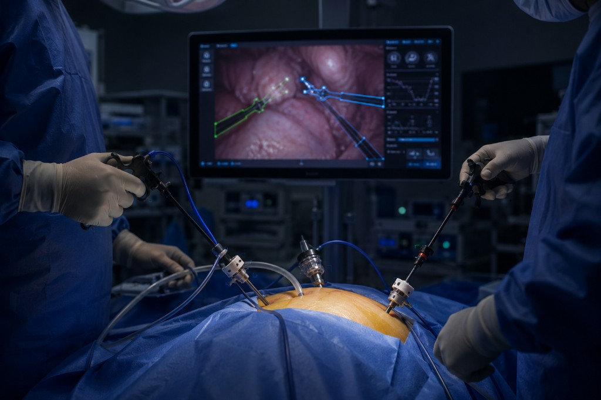

# Waverly Rose Brim

### Computer Vision • Surgical AI • Foundation Models

Building trustworthy AI systems for surgery through computer vision, foundation models, and clinical machine learning.

  

[Website](https://waverlyrose.github.io) · [Google Scholar](https://scholar.google.com/citations?user=VwZLAXoAAAAJ&hl=en) · [LinkedIn](https://www.linkedin.com/in/waverlyrosebrim/) · [Email](mailto:wrb@waverlyrose.io)

---

## Research Portfolio

**[SCRUB](https://waverlyrose.github.io/projects/1_scrub/)**  
Computer vision for robust surgical hand tracking under severe domain shift.

**[Spine Oncology RAG Service](https://waverlyrose.github.io/projects/2_spine_rag/)**  
Citation-grounded clinical decision support for multidisciplinary tumor boards.

**[MindEye2-Demo](https://waverlyrose.github.io/projects/3_mindeye2/)**  
Memory-efficient fMRI-to-image reconstruction on Apple Silicon.

**[Soft-kNN ICU Mortality](https://waverlyrose.github.io/projects/4_soft_knn/)**  
Fairness-aware calibration and imputation for clinical prediction.

**[Peritoneal Seeding Detection](https://waverlyrose.github.io/projects/9_peritoneal_seeding/)**  
Intraoperative decision support for biopsy selection in diagnostic laparoscopy.

**[Meningioma Multimodal Pipeline](https://waverlyrose.github.io/projects/5_meningioma/)**  
Computational pathology and genomics for tumor microenvironment analysis.

[View all projects ->](https://waverlyrose.github.io/projects/)

---

## Selected Publications

### Artificial Intelligence in Cataract Surgery Training

Springer - 2025

### Machine Learning Applications for Differentiation of Glioma from Brain Metastasis

Cancers - 2022

### Machine Learning in Differentiating Gliomas from Primary CNS Lymphomas

AJNR - 2022

[View Google Scholar ->](https://scholar.google.com/citations?user=VwZLAXoAAAAJ&hl=en)

---

## Selected Talks

**World Economic Forum**  
"Dr. AI" - Annual Meeting of the New Champions (2023)

**Women in Machine Learning @ ICML**  
"SCRUB: Feature Collapse and Partial Signal Recovery in Gloved-Hand Pose Estimation" (2026)

**AfroTech HealthStack**  
"Building Fairness Into the Data Supply Chain" (2026)
